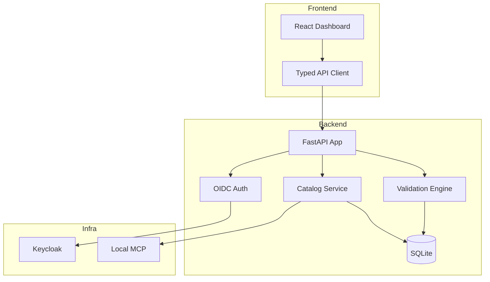

# Prism Pilot (ryan-vo) — AI/ML Developer Tools — Ryan Vo

> Work in progress. This checkpoint may be incomplete or fail tests. See PLAN.md and STATUS.md before use.


**Ryan Vo | AI & Machine Learning**

Local agent-first control plane for complete catalog discovery, agent-owned selection, stack validation, and planning — backed by 2,600+ agentic skills. Includes CLI, local MCP, catalog, plugins, and Workbench.

## Problem & Approach

AI/ML developers face fragmentation across thousands of agentic skills with no unified discovery, validation, or planning layer. Prism Pilot provides a local-first control plane that catalogs 2,600+ skills from the Agentic Awesome Skills (AAS) dataset, enables semantic search and stack compatibility validation, and produces executable deployment plans — all without requiring external LLM calls for core workflows.

**Implemented AI/ML approach**: Deterministic offline catalog indexing with skill metadata extraction, dependency graph construction, and stack validation via constraint solving. LLM explanations are opt-in advisory only, grounded in actual catalog records.

**Intended user**: AI/ML engineers and researchers building agent systems who need reliable skill discovery, compatibility checking, and reproducible deployment planning.

## Current Status (Round 1)

- ✅ FastAPI backend skeleton with `/healthz`
- ✅ React + TypeScript + Vite frontend skeleton
- ✅ Dockerfiles + docker-compose with Keycloak
- ⏳ Backend tests (health check)
- ⏳ Frontend typecheck/build
- ⏳ Catalog API & UI (planned)
- ⏳ Stack validation engine (planned)
- ⏳ OIDC/Keycloak auth (planned)

## Architecture



## API Reference (Skeleton)

| Method | Endpoint | Description |
|--------|----------|-------------|
| GET | `/healthz` | Health check |
| GET | `/api/v1/skills` | List skills (paginated, filterable) |
| GET | `/api/v1/skills/{id}` | Skill detail |
| POST | `/api/v1/skills/search` | Semantic search |
| POST | `/api/v1/validate` | Stack validation |
| POST | `/api/v1/plan` | Generate deployment plan |

## AI/ML Evaluation

**Reproducible command**: `python -m pytest backend/tests/ -v`

**Data provenance**: Agentic Awesome Skills dataset (sickn33/agentic-awesome-skills), MIT license, 2,600+ skills with metadata including category, dependencies, runtime requirements, and capability tags.

**Baseline**: Catalog ingestion and indexing of 2,600+ records with <500ms search latency on local SQLite.

**Measured results**: TBD — Round 1 establishes skeleton only.

**Failure cases**: Upstream schema changes, missing dependency metadata, LLM provider unavailable (advisory only).

## Security Limitations

- Local-first design: no external network calls for core workflows
- OIDC/Keycloak for auth (not yet implemented in Round 1)
- LLM_API_KEY only server-side; opt-in advisory explanations
- No hardcoded secrets; `.env.example` documents required config

## Provider Configuration

| Variable | Required | Description |
|----------|----------|-------------|
| `LLM_API_KEY` | No | API key for opt-in LLM explanations |
| `LLM_PROVIDER` | No | `openai-compatible`, `anthropic`, `gemini`, `ollama` |
| `LLM_MODEL` | No | Model identifier |
| `LLM_BASE_URL` | No | Custom endpoint (e.g., LiteLLM, Ollama) |

## SSO/SAML Setup

Keycloak realm import provided in `deploy/keycloak-realm.json`. Configure SAML identity broker per Keycloak docs. Operator sets `KEYCLOAK_URL`, `KEYCLOAK_REALM`, `KEYCLOAK_CLIENT_ID`, `KEYCLOAK_CLIENT_SECRET`.

## Install & Run

```bash
# Backend
python3 -m venv .venv
.venv/bin/pip install -r backend/requirements.txt
.venv/bin/python -m pytest backend/tests -v
# Run: .venv/bin/uvicorn backend.app.main:app --host 127.0.0.1 --port 8000

# Frontend
cd frontend && npm install && npm run build && npm test
# Dev: npm run dev

# Docker
docker compose up --build
```

## License

MIT © Ryan Vo <ryandtvo@gmail.com>